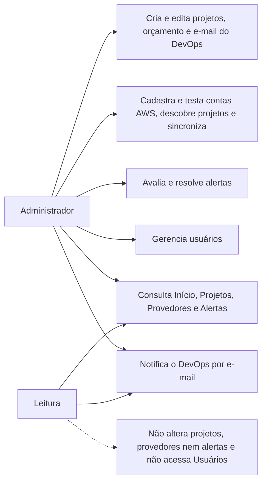
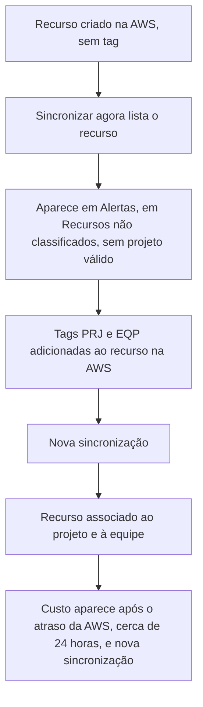

<h1 align="center">CostGuard</h1>

Quanto cada projeto gasta na nuvem, por equipe, com alertas de orçamento.

  <a href="#-1-apresentação">Apresentação</a> ·
  <a href="#-2-acesso-ao-aplicativo">Acesso</a> ·
  <a href="#-3-perfis-de-usuários">Perfis</a> ·
  <a href="#-4-funcionalidades">Funcionalidades</a> ·
  <a href="#-5-manual-de-utilização">Manual</a> ·
  <a href="#-6-exemplos-de-utilização">Exemplos</a> ·
  <a href="#-7-limitações-conhecidas">Limitações</a> ·
  <a href="#-documentos-complementares">Documentos</a>

**Índice**

1. [Apresentação](#-1-apresentação)
2. [Acesso ao aplicativo](#-2-acesso-ao-aplicativo)
3. [Perfis de usuários](#-3-perfis-de-usuários)
4. [Funcionalidades](#-4-funcionalidades)
5. [Manual de utilização](#-5-manual-de-utilização)
   - [5.1 Perfil Administrador](#51-perfil-administrador)
   - [5.2 Perfil Leitura](#52-perfil-leitura)
6. [Exemplos de utilização](#-6-exemplos-de-utilização)
7. [Limitações conhecidas](#-7-limitações-conhecidas)

Complemento: [Documentos complementares](#-documentos-complementares)

## 📖 1. Apresentação

**Nome:** CostGuard.

**Descrição:** o CostGuard mostra quanto cada projeto de uma empresa gasta na nuvem e avisa quando o gasto se aproxima do orçamento do mês. Ele lê os recursos e os custos de uma conta AWS e usa etiquetas (tags) para descobrir de qual projeto e de qual equipe cada recurso é.

**Problema que resolve:** a fatura da nuvem mostra quanto foi gasto, mas nem sempre quem gastou. Sem essa informação, é difícil cobrar responsáveis, comparar o consumo com o orçamento e perceber a tempo que um projeto está estourando o limite.

**Público-alvo:** quem administra a nuvem de uma organização (perfil Administrador) e quem precisa apenas acompanhar os gastos (perfil Leitura).

Tecnologias: Reflex, Xano e APIs da AWS.

Projeto acadêmico, Centro Universitário Impacta (ADS).

## 🔑 2. Acesso ao aplicativo

A versão publicada está em https://app.costguard.com.br (tela de login).

O acesso é feito com nome de usuário e senha.

> [!NOTE]
> Não existe cadastro pela tela de login: as contas são criadas por um administrador, na tela **Usuários** (veja a jornada 10 do Administrador). Quem ainda não tem conta deve pedir a criação ao administrador da sua organização.

## 👥 3. Perfis de usuários

Há dois perfis, definidos pelo administrador ao criar o usuário (campo **Papel**): **Administrador** e **Leitura**. O perfil de quem está conectado aparece no cartão do usuário, no rodapé do menu lateral.

| Ação                                                            | Administrador | Leitura |
| :-------------------------------------------------------------- | :-----------: | :-----: |
| Ver Início, Projetos, detalhe do projeto, Provedores e Alertas  |      Sim      |   Sim   |
| Criar e editar projetos, orçamento e e-mail do DevOps           |      Sim      |   Não   |
| Cadastrar, testar e editar contas AWS (provedores)              |      Sim      |   Não   |
| Descobrir projetos e usar Sincronizar agora                     |      Sim      |   Não   |
| Avaliar e resolver alertas                                      |      Sim      |   Não   |
| Notificar o DevOps por e-mail (orçamento e recursos sem equipe) |      Sim      |   Sim   |
| Tela Usuários (criar, editar, desativar, nova senha)            |      Sim      |   Não   |

Resumo visual do que cada perfil faz:

> [!NOTE]
> A permissão é verificada no servidor (Xano), não apenas escondendo botões na tela.

## 🧩 4. Funcionalidades

- **Início:** visão geral do mês, com os indicadores Custo classificado (mês), Projetos ativos, Alertas abertos e Não classificados, a lista dos projetos que mais consumiram o orçamento e os alertas abertos mais recentes.
- **Projetos:** um cartão por projeto, com o custo classificado do mês, o orçamento mensal, o percentual consumido e a faixa de alerta. Seletor de mês (mês atual e os 5 anteriores). O administrador cria, edita e desativa projetos.
- **Detalhe do projeto:** custo do mês, orçamento restante, custo por equipe e recursos agrupados por equipe, além da seção **Recursos sem equipe**.
- **Atribuição por tags:** o projeto e a equipe de cada recurso vêm das tags da AWS (`PRJ` para o projeto e `EQP` para a equipe). Recursos sem projeto válido ficam como não classificados.
- **Provedores:** cadastro de contas AWS com credencial somente de leitura, teste de conexão, edição e desativação, além da descoberta e importação de projetos a partir das tags.
- **Sincronização:** o botão **Sincronizar agora** importa o inventário de recursos, os custos por equipe e reavalia os alertas.
- **Orçamento e faixas de alerta:** orçamento mensal em dólares por projeto, comparado com o custo do mês nas faixas de 70%, 90% e 100%.
- **Alertas:** lista de alertas de orçamento, de recursos sem classificação e de falhas de importação, com filtro, busca, avaliação sob demanda e resolução. O total de alertas abertos aparece na barra superior.
- **Notificação por e-mail ao DevOps:** envio manual, a partir do detalhe do projeto, sobre o orçamento ou sobre os recursos sem equipe.
- **Usuários:** o administrador cria, edita, desativa e reativa usuários e define nova senha.
- **Ajuda e conta:** os ícones de **Ajuda** e **Minha conta** na barra superior abrem janelas de apoio; **Encerrar Sessão**, no menu lateral, sai do sistema.

## 📘 5. Manual de utilização

O menu lateral tem os itens **Início**, **Projetos**, **Provedores**, **Alertas** e, apenas para o administrador, **Usuários**. Abaixo do menu ficam o nome do usuário conectado, o perfil e o botão **Encerrar Sessão**. A barra superior tem o campo de busca (em algumas telas), o contador de alertas abertos e os ícones de **Minha conta** e **Ajuda**.

Cada jornada abaixo abre e fecha com um clique no título.

### 5.1 Perfil Administrador

> [!TIP]
> Ordem sugerida para começar: cadastre o provedor e use **Testar** até ele ficar **Conectado** (jornada 2); crie ou importe os projetos (jornada 5); marque os recursos com as tags `PRJ` e `EQP` na AWS (jornada 6); e clique em **Sincronizar agora** (jornada 3).

> [!WARNING]
> As ações do administrador alteram dados do sistema: criar, editar e desativar projetos e provedores, resolver alertas, criar, desativar e reativar usuários e definir nova senha (a senha anterior deixa de funcionar imediatamente). **Sincronizar agora** e **Descobrir projetos** consultam o Cost Explorer da AWS, que cobra por consulta.

<strong>Jornada 1. Entrar no sistema</strong>

1. Abra a tela de login. Ela mostra o título "Bem-vindo de volta" e os campos **Usuário** e **Senha**. O ícone de olho ao lado da senha mostra ou oculta o que foi digitado.
2. Informe o nome de usuário e a senha e clique em **Entrar**.
3. Resultado esperado: você chega ao **Início** ("Visão geral"), com os quatro indicadores do mês, o bloco "Maiores consumos do orçamento", o bloco "Alertas abertos recentes" e os atalhos para Projetos, Provedores e Alertas. O botão com setas circulares ao lado do seletor de mês atualiza os dados.
4. Se o usuário ou a senha estiverem errados, a tela mostra o aviso "Usuário ou senha inválidos." e permanece no login.

<strong>Jornada 2. Cadastrar um provedor AWS</strong>

1. No menu, abra **Provedores** e clique em **Novo provedor**. Abre-se uma janela com o campo **Provedor** (deixe **AWS**) e os campos do cadastro.
2. Preencha **Apelido**, **Identificador da conta (AWS Account ID)** (o número da conta AWS, 12 dígitos), **Tag Key de projeto** (já vem preenchido com `PRJ`), **AWS Access Key ID** e **AWS Secret Access Key** (use uma credencial somente de leitura).
3. Clique em **Salvar**. A janela fecha, a tela confirma "Provedor salvo." e o provedor aparece na lista com o status **Pendente**.
4. Na linha do provedor, clique em **Testar**. Se a chave for válida, a tela confirma "Conexão com a AWS confirmada." e o status muda para **Conectado**; se não, o status muda para **Com erro**, com o motivo na tela.

A lista tem as colunas Apelido, Tipo, Conta (parcialmente oculta), Status, Inventário (situação da última sincronização) e Ações. A chave secreta é guardada cifrada e não aparece de novo depois de salva. Na edição, deixar os campos de chave em branco mantém a chave atual.

<strong>Jornada 3. Sincronizar</strong>

1. Em **Provedores**, na linha do provedor **Conectado**, clique em **Sincronizar agora**.
2. Abre-se a janela "Sincronizar" seguida do apelido do provedor, com três etapas: **Inventário de recursos**, **Custos por equipe** e **Avaliação de alertas**. Cada etapa mostra um ícone e uma mensagem: andamento, sucesso, aviso ou erro.
3. Ao terminar, clique em **Fechar**. Resultado esperado: a coluna **Inventário** da lista passa a mostrar a sincronização recente. Se alguma etapa falhar, a janela avisa que a falha ficou registrada e aparece em **Alertas**.

<strong>Jornada 4. Ver os recursos</strong>

1. Recursos que já pertencem a um projeto aparecem no detalhe do projeto (jornada 8), agrupados por equipe. Cada grupo tem um cabeçalho com o nome da equipe e a quantidade de recursos, que pode ser recolhido ou expandido com um clique. A tabela mostra as colunas **Recurso**, **Serviço**, **Região** e **Custo (USD)**. Os que têm projeto, mas não têm equipe, ficam na seção **Recursos sem equipe**.
2. Recursos sem projeto válido aparecem em **Alertas**, no bloco **Recursos não classificados**, com as colunas RECURSO, SERVIÇO, REGIÃO, PROVEDOR e TAG DE PROJETO. A última coluna mostra o valor encontrado na tag ou "sem tag".
3. Recursos descobertos há menos de 48 horas recebem a etiqueta **Novo · custo ainda não disponível**.

O custo é mostrado por projeto e por equipe. A coluna **Custo (USD)** da tabela de recursos é opcional e aparece como "0,00" enquanto não houver valor informado (veja as Limitações).

<strong>Jornada 5. Criar e editar projetos</strong>

1. Em **Projetos**, cada cartão mostra o nome, o código, a situação (Ativo ou Inativo), o custo classificado do mês, o orçamento, a barra e o percentual consumido com a faixa de alerta. No alto da tela há o seletor de mês (mês atual e os 5 anteriores).
2. Para criar, clique em **Novo projeto**. Na janela, informe **Nome**, **Código** (o mesmo valor da tag de projeto na AWS; não pode ser alterado depois), **Orçamento mensal (US$)** e, se quiser, **E-mail do DevOps**. Clique em **Salvar**; a tela confirma "Projeto salvo." e o cartão novo aparece.
3. Para editar, clique em **Editar** no cartão. Você pode mudar o nome, o orçamento mensal e o e-mail do DevOps. Deixar o e-mail em branco mantém o atual; para apagá-lo, clique em **Remover e-mail** e confirme em **Confirmar remoção** (a janela avisa que o projeto ficará sem destinatário; o botão **Desfazer remoção** cancela a remoção antes de salvar).
4. O botão **Desativar** do cartão desativa o projeto.
5. Outra forma de criar projetos: em **Provedores**, clique em **Descobrir projetos**. A janela lista os valores da tag de projeto encontrados na AWS, cada um marcado como **Novo** ou **Já existe**. Marque os novos (ou use **Selecionar todos os novos**) e clique em **Importar selecionados**. A tela informa quantos projetos foram importados. Os projetos importados começam com orçamento 0.

<strong>Jornada 6. Atribuir um recurso a um projeto e a uma equipe</strong>

A atribuição é feita na AWS, com tags, e não dentro do CostGuard.

1. Garanta que o projeto existe no CostGuard com o código igual ao valor que será usado na tag.
2. Na AWS, adicione ao recurso a tag `PRJ` com o código do projeto e, se quiser equipe, a tag `EQP` com o código da equipe.
3. No CostGuard, clique em **Sincronizar agora**.
4. Resultado esperado: o recurso sai de **Recursos não classificados** e aparece no detalhe do projeto, sob a equipe da tag `EQP` (que é criada na hora, se for nova) ou em **Recursos sem equipe**.

Se o código da tag `PRJ` não corresponder a um projeto, o recurso continua não classificado e fica fora de qualquer orçamento. A equipe só vale quando o projeto é válido.

<strong>Jornada 7. Orçamento e faixas de alerta</strong>

1. O orçamento é mensal, em dólares, e pertence ao projeto. Defina-o ao criar ou editar o projeto (jornada 5).
2. O CostGuard compara o custo do mês, já atribuído ao projeto, com o orçamento e mostra o percentual no cartão do projeto, com uma etiqueta colorida da faixa.
3. As faixas são:

| Consumo do orçamento | Faixa                                                          |
| :------------------- | :------------------------------------------------------------- |
| Abaixo de 70%        | Normal (sem alerta)                                            |
| 70% ou mais          | Atenção                                                        |
| 90% ou mais          | Aviso (chamado de Crítico na lista de projetos)                |
| 100% ou mais         | Orçamento excedido (chamado de Estourado na lista de projetos) |

4. Projeto com orçamento 0 aparece como "Sem orçamento definido" e não gera alerta.
5. Os alertas são recalculados ao usar **Sincronizar agora**, ao usar **Avaliar alertas agora** e ao alterar o orçamento de um projeto.

<strong>Jornada 8. Detalhe do projeto e notificação do DevOps por e-mail</strong>

Clique no cartão do projeto, em **Projetos** (ou em um projeto da lista do **Início**). A tela mostra, de cima para baixo:

- o caminho "PROJETOS" (link para voltar), o nome do projeto, a situação e o período;
- o seletor de mês e dois botões, **Notificar orçamento** e **Notificar recursos sem equipe**;
- dois cartões: **Custo classificado no mês** e **Orçamento restante** (com barra e percentual);
- o bloco **Custo por equipe**, com uma barra por equipe;
- o bloco **Recursos detalhados por equipe**, com os grupos de recursos, e a seção **Recursos sem equipe**.

Os dois botões de notificação:

- **Notificar orçamento**: envia ao e-mail do DevOps do projeto o mês, o orçamento, o gasto, o percentual consumido, a faixa e a quantidade de recursos sem equipe.
- **Notificar recursos sem equipe**: envia a lista dos recursos do projeto que estão sem equipe (até 50 itens).

Como usar:

1. O projeto precisa estar ativo e ter o e-mail do DevOps cadastrado (jornada 5). Sem isso, os botões ficam desabilitados e a tela mostra a dica "defina o e-mail do DevOps no projeto".
2. O botão de recursos também fica desabilitado, com o texto "Nenhum recurso sem equipe", quando o projeto não tem recursos sem equipe.
3. Clique no botão. Resultado esperado: a tela confirma o envio, e o botão fica indisponível por alguns minutos. O e-mail sempre vai para o endereço cadastrado no projeto; não é possível digitar outro destinatário.
4. Os envios são sempre manuais: o sistema nunca envia e-mail sozinho.

Há limites de envio de e-mail; a tela informa quando o limite é atingido.

<strong>Jornada 9. Alertas</strong>

1. Abra **Alertas**. Quatro indicadores mostram os alertas abertos, os críticos abertos, os disparados nas últimas 24 horas e os recursos não classificados.
2. Abaixo, a lista de alertas tem o filtro **Abertos**, **Resolvidos** ou **Todos**. O campo de busca fica na barra superior. Cada alerta mostra o nível, o tipo, a mensagem (com link para o projeto, quando houver) e há quanto tempo foi gerado.
3. Clique em **Avaliar alertas agora** para recalcular; a tela informa quantos alertas novos foram criados e quantos foram encerrados automaticamente. Clique em **Resolver**, na linha do alerta, para encerrar um alerta aberto; ele passa a aparecer como resolvido.
4. Alertas cuja situação deixa de existir (por exemplo, o consumo voltou para baixo da faixa) são encerrados automaticamente na avaliação seguinte.
5. O contador de alertas abertos aparece também na barra superior, e um clique nele abre esta tela.

Mais abaixo fica o bloco **Recursos não classificados** (jornada 4).

<strong>Jornada 10. Usuários</strong>

1. Abra **Usuários** no menu ("Usuários & Acessos"). Os indicadores mostram o total de usuários, os administradores e os ativos. A tabela lista o usuário, o e-mail, o papel, o status e as ações.
2. Clique em **Novo usuário** e informe **Nome completo**, **Nome de usuário (login)** (sem espaços; não muda depois), **E-mail**, **Papel** (**Leitura — somente consulta** ou **Administrador**) e **Senha inicial**. Clique em **Criar usuário**; a tela confirma "Usuário criado." e o usuário aparece na tabela. Entregue a senha ao usuário por um canal seguro.
3. Nas ações de cada linha há ícones com dica ao passar o mouse: **Editar**, **Definir nova senha** (abre uma janela com o campo **Nova senha** e o botão **Definir senha**; a senha anterior deixa de funcionar imediatamente) e **Desativar usuário** ou **Reativar usuário**. Usuários não são excluídos.
4. O sistema não deixa desativar o próprio usuário (a linha dele mostra a marca "você" e não tem o ícone de desativar) nem o último administrador ativo.

### 5.2 Perfil Leitura

O perfil Leitura serve para acompanhar os gastos, sem alterar nada. A tela de login e o menu são os mesmos, sem o item **Usuários**.

<strong>Jornada 1. Entrar no sistema</strong>

Mesmo fluxo da jornada 1 do Administrador: informe usuário e senha e clique em **Entrar**. Resultado esperado: o **Início**, com os mesmos indicadores e blocos.

<strong>Jornada 2. Acompanhar projetos, provedores e alertas</strong>

1. Em **Projetos**, veja os cartões com custo, orçamento, percentual e faixa, trocando o mês no seletor. Clique em um cartão para abrir o detalhe, com o custo por equipe e os recursos de cada projeto. Os botões **Novo projeto**, **Editar** e **Desativar** não aparecem.
2. Em **Provedores**, veja a lista com status e situação da sincronização. Os botões **Novo provedor**, **Sincronizar agora**, **Testar**, **Descobrir projetos**, **Editar** e **Desativar** não aparecem, e a coluna Ações fica vazia.
3. Em **Alertas**, veja os indicadores, a lista (com o filtro Abertos, Resolvidos ou Todos) e os recursos não classificados. Os botões **Avaliar alertas agora** e **Resolver** não aparecem.

<strong>Jornada 3. Notificar o DevOps por e-mail</strong>

No detalhe do projeto, use **Notificar orçamento** e **Notificar recursos sem equipe**, com as mesmas regras e limites da jornada 8 do Administrador. A resposta da tela para o perfil Leitura não mostra o endereço de e-mail do DevOps, e o perfil apenas vê se há e-mail cadastrado: não consegue criá-lo nem alterá-lo.

#### O que o perfil Leitura não consegue

- Criar ou editar projetos, orçamentos e o e-mail do DevOps.
- Cadastrar, testar, editar ou desativar provedores, descobrir projetos ou sincronizar.
- Avaliar ou resolver alertas.
- Acessar **Usuários**: o item não aparece no menu e, se a página for aberta pelo endereço, a tela informa "A gestão de usuários é restrita a administradores."

## 💡 6. Exemplos de utilização

Do recurso criado na AWS até o custo no CostGuard:

> [!IMPORTANT]
> O custo de um recurso novo só aparece depois do atraso da AWS (cerca de 24 horas) e de uma nova sincronização. Além disso, as tags de projeto e de equipe precisam estar ativadas como tags de alocação de custos (cost allocation tags) na AWS; sem isso, o custo não é separado por projeto e equipe (veja as Limitações).

**a) Criar um recurso na AWS e vê-lo no CostGuard, mesmo sem tag e sem custo**

1. Na AWS, crie um recurso de um dos tipos lidos pelo CostGuard (servidor EC2, disco EBS, banco RDS, bucket S3, função Lambda ou tabela DynamoDB), sem nenhuma tag, na conta cadastrada.
2. Aguarde a AWS listar o recurso (pode levar alguns minutos ou mais) e clique em **Sincronizar agora**.
3. Em **Alertas**, no bloco **Recursos não classificados**, o recurso aparece com "sem tag" na coluna TAG DE PROJETO e com a etiqueta **Novo · custo ainda não disponível**. Nenhum valor de custo é exibido para ele.

**b) Recurso com tags PRJ e EQP aparecendo no projeto e na equipe**

1. Na AWS, marque o recurso com `PRJ` igual ao código de um projeto existente no CostGuard e `EQP` com o código da equipe.
2. No CostGuard, clique em **Sincronizar agora**.
3. No detalhe do projeto, o recurso aparece sob a equipe indicada; se a equipe ainda não existia, ela é criada. O custo da equipe só passa a aparecer depois que a AWS publicar o gasto (cerca de 24 horas) e que uma nova sincronização buscar os custos.

**c) Editar e excluir o recurso na AWS**

1. Altere as tags do recurso na AWS (por exemplo, mude o `EQP`) ou exclua o recurso.
2. Nada muda na hora no CostGuard: a mudança aparece **na próxima sincronização** do inventário, feita pelo botão **Sincronizar agora** ou, se o administrador do servidor tiver ligado a sincronização automática, no próximo ciclo dela.
3. Tag alterada: o recurso é reclassificado para o novo projeto ou equipe. Recurso excluído: ele é marcado como inativo e some do detalhe do projeto e dos recursos não classificados.
4. Se a sincronização falhar, nenhum recurso é removido, e o erro é mostrado em **Provedores** e em **Alertas**.

**d) Definir orçamento e enviar e-mail ao DevOps**

1. Em **Projetos**, clique em **Editar** no cartão, informe o **Orçamento mensal (US$)** e o **E-mail do DevOps** e salve. Se o orçamento mudou, os alertas são recalculados.
2. Abra o projeto e clique em **Notificar orçamento**.
3. A tela confirma o envio (o administrador vê o endereço parcialmente oculto). O DevOps recebe o e-mail com o gasto, o percentual e a faixa do projeto. Há limites de envio de e-mail; a tela informa quando o limite é atingido.

## 🚧 7. Limitações conhecidas

| Limitação                            | O que significa                                                                                                                                                                                                                                                                 |
| :----------------------------------- | :------------------------------------------------------------------------------------------------------------------------------------------------------------------------------------------------------------------------------------------------------------------------------ |
| **Custo de recurso novo demora**     | O custo de um recurso novo leva cerca de 24 horas para aparecer. Até lá o CostGuard mostra "custo ainda não disponível".                                                                                                                                                        |
| **Tags de custo na AWS**             | As tags de projeto e de equipe precisam estar ativadas como tags de alocação de custos (cost allocation tags) na AWS. Sem isso, o custo não é separado por projeto e equipe.                                                                                                    |
| **Recursos novos na AWS**            | A AWS pode levar alguns minutos ou mais para listar um recurso novo. O CostGuard só enxerga o que a busca de recursos da AWS (Resource Explorer) lista, nos seis tipos de recurso citados nos exemplos.                                                                         |
| **Custo do Cost Explorer**           | O Cost Explorer da AWS cobra por consulta. O CostGuard o consulta apenas quando o administrador usa **Sincronizar agora** (etapa de custos) ou **Descobrir projetos**. A navegação, o botão **Testar**, **Avaliar alertas agora** e a sincronização automática não o consultam. |
| **Sincronização automática**         | É opcional e vem desligada por padrão. Quando ligada, atualiza só a lista de recursos, não os custos, e funciona apenas enquanto o servidor do aplicativo está no ar.                                                                                                           |
| **Limite do plano gratuito do Xano** | O plano gratuito limita o número de requisições por intervalo. As telas podem demorar ou mostrar "Muitas requisições em pouco tempo".                                                                                                                                           |
| **Azure**                            | Há suporte à leitura de custo do Azure, ainda não validado com valores reais.                                                                                                                                                                                                   |
| **Custo por recurso**                | Campo opcional, ainda sem coleta automática; a AWS só entrega custo por recurso com a opção de dados por recurso habilitada no Cost Explorer.                                                                                                                                   |
| **Telas pequenas**                   | A interface é pensada para computador. Em telas estreitas, o menu lateral e a barra superior ficam ocultos e não há menu alternativo.                                                                                                                                           |
| **Senha**                            | Não há recuperação de senha pela tela. Um administrador define uma nova senha em **Usuários**.                                                                                                                                                                                  |
| **Fontes externas**                  | A interface carrega as fontes de texto do Google, portanto precisa de acesso à internet para exibi-las.                                                                                                                                                                         |
| **Projeto acadêmico**                | Não tem o endurecimento esperado de um sistema em produção.                                                                                                                                                                                                                     |

## 📚 Documentos complementares

- [Visão geral do projeto](docs/project-overview.md)
- [Modelo de domínio](docs/domain-model.md)

A pasta `openspec/` contém especificações e mudanças registradas do projeto.
