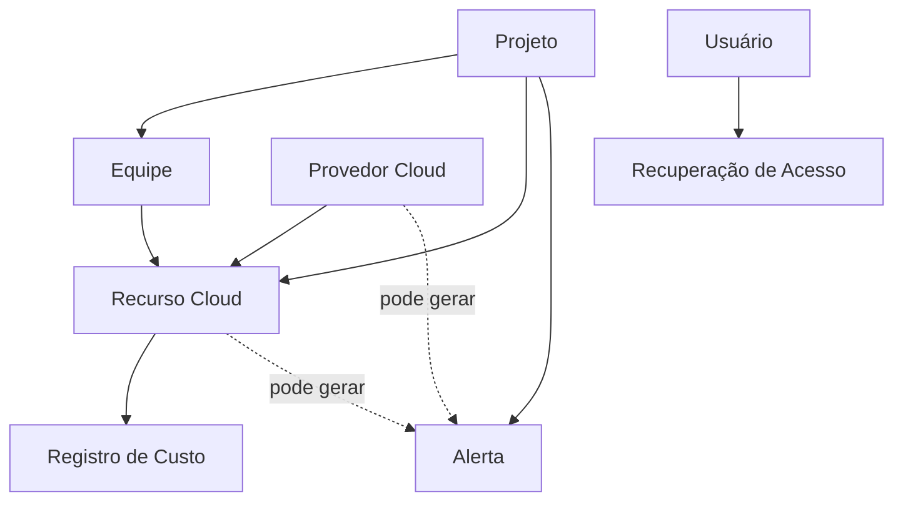
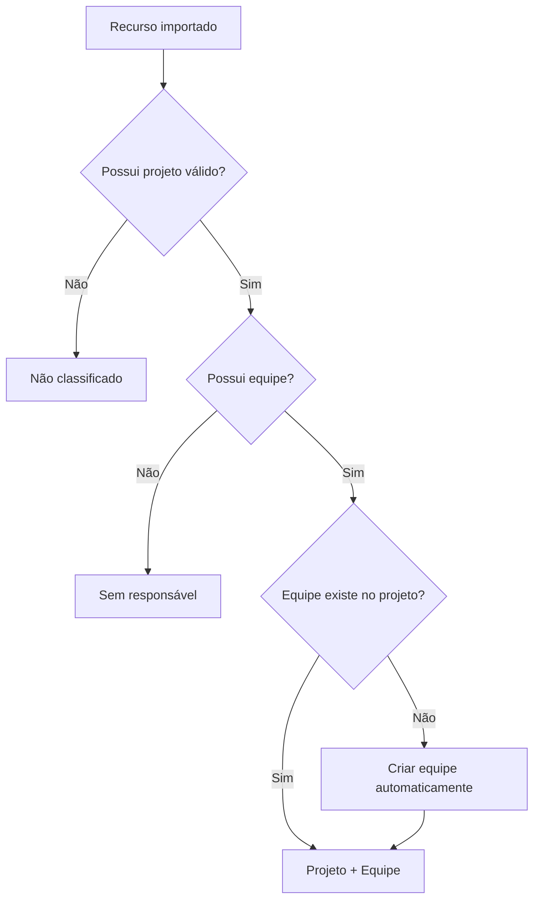

# Domain Model — CostGuard

## 1. Visão geral do domínio

O domínio do CostGuard é a gestão e responsabilização de custos de computação em nuvem.

O sistema relaciona recursos existentes em um provedor cloud a projetos e equipes por meio de tags. A partir dessa classificação, os custos são consolidados, comparados com o orçamento mensal de cada projeto e utilizados para geração de alertas.

Os principais conceitos do domínio são:

- Usuário;
- Projeto;
- Equipe;
- Provedor;
- Recurso;
- Registro de custo;
- Alerta;
- Recuperação de acesso.

## 2. Relacionamento geral



O diagrama representa os relacionamentos conceituais do domínio e não necessariamente a estrutura física do banco de dados.

---

# 3. Usuário

## Descrição

Representa uma pessoa autorizada a acessar o CostGuard.

Os usuários são criados por administradores. Não existe autocadastro.

## Responsabilidade

Permitir acesso controlado às funcionalidades e informações do sistema.

## Principais informações

- nome;
- nome de usuário;
- e-mail;
- papel;
- status.

A senha não é considerada uma informação armazenável em texto puro. O sistema deve manter apenas a representação segura necessária para autenticação.

## Papéis

Existem dois papéis:

### Admin

Pode realizar operações administrativas e de escrita previstas pelo sistema.

### Leitura

Pode consultar informações, mas não pode criar, alterar ou excluir dados.

## Relacionamentos

Um usuário pode solicitar recuperação de acesso.

Usuários não pertencem diretamente a projetos ou equipes.

## Regras estruturais

- o nome de usuário é utilizado para autenticação;
- o e-mail é utilizado como canal de recuperação de acesso;
- não existe autocadastro;
- usuários não devem ser excluídos definitivamente, mas podem ser desativados;
- o sistema deve preservar pelo menos um administrador ativo;
- autorização deve ser validada no backend.

---

# 4. Projeto

## Descrição

Representa uma iniciativa da organização à qual custos de recursos cloud podem ser atribuídos.

O projeto é o principal agrupador financeiro do CostGuard.

## Responsabilidade

Concentrar os custos relacionados a uma iniciativa e compará-los com seu orçamento mensal.

## Principais informações

- nome;
- código;
- orçamento mensal;
- status.

O código do projeto é utilizado na convenção de tags dos recursos cloud. A tag é um par
Key/Value em que a Key identifica a finalidade (Key recomendada `PRJ`) e o Value é diretamente
o código do projeto.

Exemplo conceitual:

```text
Key   = PRJ
Value = PAGAMENTOS
```

onde `PAGAMENTOS` representa o código do projeto.

## Relacionamentos

Um projeto:

- pode possuir várias equipes;
- pode possuir vários recursos;
- possui um orçamento mensal;
- pode gerar alertas;
- recebe os custos dos recursos classificados como pertencentes a ele.

## Regras estruturais

- orçamento pertence ao projeto;
- equipe não possui orçamento próprio;
- o projeto deve ser identificado antes da equipe durante a classificação de um recurso;
- recursos associados ao projeto sem equipe continuam fazendo parte de seu consumo;
- o orçamento inicial é mensal;
- a moeda utilizada inicialmente é USD.

---

# 5. Equipe

## Descrição

Representa um grupo responsável por determinados recursos dentro de um projeto.

Exemplos:

- Backend;
- Dados;
- Mobile.

## Responsabilidade

Permitir identificar qual grupo dentro de um projeto é responsável pelo consumo de determinado recurso.

## Principais informações

- nome;
- código;
- indicação de origem automática ou manual.

O código da equipe é utilizado na convenção de tags. A tag de equipe é um par Key/Value em que a Key identifica a finalidade (Key recomendada `EQP`) e o Value é diretamente o código da equipe.

Exemplo conceitual:

```text
Key   = EQP
Value = BACKEND
```

onde `BACKEND` representa o código da equipe. No AWS Cost Explorer esse par aparece como `EQP$BACKEND` (representação do Cost Explorer, não o formato da tag gravada no recurso).

## Relacionamentos

- uma equipe pertence a um projeto;
- um projeto pode possuir várias equipes;
- uma equipe pode ser responsável por vários recursos;
- um recurso pertence a no máximo uma equipe em determinado momento.

## Regras estruturais

- uma equipe sempre está contextualizada dentro de um projeto;
- equipes não possuem orçamento próprio;
- o mesmo código de equipe pode existir em projetos diferentes;
- uma equipe pode ser criada automaticamente quando uma tag válida indicar uma equipe ainda desconhecida;
- equipes criadas automaticamente devem poder ser identificadas como tal;
- não existe rateio de um único recurso entre várias equipes no escopo inicial.

---

# 6. Provedor Cloud

## Descrição

Representa uma conta ou ambiente de computação em nuvem conectado ao CostGuard.

A primeira versão do projeto utilizará AWS.

## Responsabilidade

Fornecer ao sistema informações sobre recursos, custos e tags necessárias para classificação.

## Principais informações

- nome ou apelido;
- tipo do provedor;
- identificação da conta;
- forma de autenticação;
- credencial de integração;
- estado da integração.

## Relacionamentos

- um provedor possui recursos;
- recursos importados são associados ao provedor de origem;
- falhas na integração podem gerar alertas.

## Regras estruturais

- as credenciais utilizadas pelo CostGuard devem possuir somente as permissões necessárias;
- o sistema não deve precisar criar, alterar ou excluir recursos no provedor cloud;
- falhas de importação não podem ocorrer silenciosamente;
- o provedor deve poder ser identificado como estando em estado normal ou com problema de integração.

## Ambiente de teste: AWS Mock (opcional)

Para fins de desenvolvimento e teste, um provedor AWS pode ser marcado com a característica
`usar_mock` (booleano, default `false`). Isso NÃO cria um novo tipo de provedor: o provedor
continua sendo do tipo AWS.

- `usar_mock = false` (padrão): o provedor usa exclusivamente a AWS real (STS no teste de
  conexão, Cost Explorer real na coleta). Este é o comportamento histórico e não depende do
  ambiente Mock de forma alguma.
- `usar_mock = true`: as chamadas ao Cost Explorer do provedor são direcionadas ao AWS Mock
  Simulator, em `{MOCK_BASE_URL}/aws/{identificador_conta}/ce/`, onde `MOCK_BASE_URL` é uma
  variável de ambiente existente **apenas no backend** (nunca exposta ao frontend) e
  `{identificador_conta}` é o Account ID do próprio provedor.

Regras e características:

- **Múltiplas contas**: pode haver N provedores Mock, cada um com seu próprio apelido, Account
  ID, Access Key e Secret. Não existe Account ID global nem credenciais Mock embutidas no
  código; os nomes de laboratório (ex.: AWS-DEV, AWS-PROD) são apenas dados de teste e podem
  mudar quando o ambiente Mock é regenerado.
- **Credenciais fictícias**: contas Mock devem usar SOMENTE as credenciais fictícias geradas
  pelo AWS Mock Simulator. O Secret é cifrado pelo mesmo mecanismo JWE da AWS real, nunca
  retornado por API e decifrado apenas em memória. Credenciais AWS reais nunca são enviadas ao
  Mock, e credenciais Mock nunca são usadas em endpoints AWS reais.
- **Assinatura SigV4**: a mesma implementação de SigV4 é usada nos dois casos; apenas o host, o
  canonical URI e a URL de destino mudam conforme o destino efetivo (AWS real ou Mock), para
  que a assinatura seja tecnicamente coerente.
- **Teste de conexão**: com `usar_mock = true`, o teste NÃO chama STS; faz uma chamada
  `GetTags` (TagKey `PRJ`) ao Cost Explorer do Mock. Ele valida comunicação HTTPS, endpoint,
  Account ID, contrato do Cost Explorer e a geração/envio do fluxo SigV4 pelo CostGuard — mas
  **não** comprova que Access Key/Secret estejam corretas, pois o Mock atualmente não valida
  SigV4. Uma lista de Tags vazia é considerada conexão válida.
- **Isolamento**: indisponibilidade, erro ou remoção do Mock não afeta provedores reais. O
  caminho `usar_mock = false` não lê nem depende de `MOCK_BASE_URL`.

---

# 7. Recurso Cloud

## Descrição

Representa um recurso existente no provedor de nuvem que possui custo associado.

Exemplos conceituais:

- máquina virtual;
- banco de dados;
- bucket;
- cluster.

## Responsabilidade

Ser a unidade básica sobre a qual o CostGuard identifica propriedade e associa custos.

## Principais informações

- identificação do recurso;
- nome;
- provedor de origem;
- tags recebidas do provedor;
- projeto associado;
- equipe associada, quando aplicável.

## Relacionamentos

- um recurso pertence a um provedor;
- um recurso pode estar associado a um projeto;
- um recurso pode estar associado a uma equipe;
- um recurso gera registros de custo.

## Regras estruturais

A classificação deve sempre seguir esta ordem:

```text
Recurso
   ↓
Projeto
   ↓
Equipe
```

O projeto sempre deve ser resolvido antes da equipe.

### Recurso classificado

Possui projeto válido e equipe válida.

### Sem responsável

Possui projeto válido, mas não possui uma equipe identificada.

Nesse estado:

- continua pertencendo ao projeto;
- seu custo continua sendo contabilizado no orçamento do projeto.

### Não classificado

Não possui um projeto válido.

Nesse estado:

- não pertence a qualquer orçamento;
- deve permanecer visível no sistema;
- deve gerar atenção para o administrador.

## Reatribuição

A fonte de verdade para a classificação é o provedor cloud.

Se um recurso estiver associado ao projeto ou equipe incorretos, a correção deve ser realizada alterando suas tags no provedor.

Na próxima importação, o CostGuard deverá reavaliar automaticamente sua classificação.

Não deve existir uma classificação manual paralela no CostGuard capaz de substituir permanentemente as tags da origem.

---

# 8. Convenção de Tags

## Descrição

As tags são utilizadas para determinar automaticamente o projeto e a equipe responsáveis por um recurso.

Cada tag é um par Key/Value: a **Key** identifica a finalidade da tag e o **Value** é diretamente o código do projeto ou da equipe. A Key é configurável por provedor; os valores recomendados pelo CostGuard são `PRJ` (projeto) e `EQP` (equipe).

## Tag de projeto

Key recomendada `PRJ`; o Value é o código do projeto.

Exemplo:

```text
Key   = PRJ
Value = PAGAMENTOS
```

No AWS Cost Explorer (agrupamento por tag) esse par aparece como `PRJ$PAGAMENTOS`, do qual se extrai o código `PAGAMENTOS`.

## Tag de equipe

Key recomendada `EQP`; o Value é o código da equipe.

Exemplo:

```text
Key   = EQP
Value = BACKEND
```

No AWS Cost Explorer (agrupamento por tag) esse par aparece como `EQP$BACKEND`, do qual se extrai o código `BACKEND`. Essa forma `EQP$BACKEND` (assim como `PRJ$PAGAMENTOS`) é a **representação do Cost Explorer**, não o formato da tag gravada no recurso: na nuvem, a tag é sempre o par `Key = EQP` / `Value = BACKEND`.

## Regras

- a tag de projeto é avaliada antes da tag de equipe;
- sem projeto válido, a equipe não define responsabilidade financeira;
- ausência de equipe não impede o custo de ser atribuído ao projeto;
- uma equipe desconhecida indicada por uma tag válida pode ser criada automaticamente;
- nenhum custo deve ser descartado por problema de classificação.

---

# 9. Registro de Custo

## Descrição

Representa o custo de um recurso cloud em determinado período.

## Responsabilidade

Permitir consolidar quanto cada recurso consumiu e, consequentemente, calcular o consumo de projetos e equipes.

## Principais informações

- recurso relacionado;
- período;
- valor do custo;
- momento da importação.

## Relacionamentos

- um recurso pode possuir registros de custo;
- registros de custo são utilizados para calcular o consumo do projeto;
- o consumo das equipes é derivado dos recursos atribuídos a elas.

## Regras estruturais

- o período inicial de controle é mensal;
- a moeda utilizada inicialmente é USD;
- o custo do mês corrente pode ser atualizado conforme novas importações forem realizadas;
- o sistema não deve descartar custos apenas porque um recurso está mal classificado.

O detalhamento físico sobre como o histórico de custos e mudanças de classificação serão persistidos deverá ser definido durante as changes correspondentes.

---

# 10. Orçamento

## Descrição

Representa o limite mensal de gasto definido para um projeto.

O orçamento é um conceito pertencente ao projeto e não uma entidade independente de responsabilidade.

## Responsabilidade

Servir como referência para comparar o consumo acumulado do projeto.

## Relacionamentos

O orçamento é comparado com a soma dos custos de:

- recursos atribuídos às equipes do projeto;
- recursos do projeto classificados como "Sem responsável".

Recursos "Não classificados" não fazem parte de qualquer orçamento enquanto não possuírem projeto válido.

## Regras

O orçamento:

- é mensal;
- pertence somente ao projeto;
- é expresso inicialmente em USD;
- não existe por equipe;
- não possui rateio entre equipes.

---

# 11. Alerta

## Descrição

Representa uma situação identificada pelo sistema que necessita de atenção.

## Responsabilidade

Informar usuários administrativos sobre condições relevantes detectadas automaticamente.

## Tipos inicialmente previstos

### Alerta de orçamento

Gerado quando o consumo de um projeto alcança determinados níveis.

Faixas previstas:

- 70% — atenção;
- 90% — aviso;
- 100% ou mais — orçamento excedido.

### Alerta de recurso não classificado

Gerado quando um recurso não possui projeto válido.

### Alerta de importação

Gerado quando o sistema não consegue importar corretamente informações de um provedor.

## Principais informações

- tipo;
- nível;
- mensagem;
- estado de resolução.

## Relacionamentos

Dependendo do tipo, um alerta pode estar relacionado a:

- projeto;
- recurso;
- provedor.

## Regras estruturais

- falhas de importação nunca devem ser silenciosas;
- alertas de orçamento não devem ser repetidos continuamente sem necessidade;
- uma faixa de orçamento deve gerar aviso apenas quando a condição correspondente for alcançada conforme a regra definida pelo sistema.

O detalhamento de persistência, ciclo de vida e deduplicação dos alertas deverá ser definido na especificação da funcionalidade.

---

# 12. Recuperação de Acesso

## Descrição

Representa o processo utilizado para permitir que um usuário redefina sua senha quando não consegue acessar o sistema.

## Responsabilidade

Permitir redefinição segura da senha sem revelar informações indevidas sobre usuários existentes.

## Relacionamentos

- pertence a um usuário quando a solicitação corresponde a uma conta válida;
- utiliza o e-mail associado ao usuário como canal de comunicação.

## Regras estruturais

- a resposta ao solicitante não deve revelar se a conta existe;
- o mecanismo de redefinição deve possuir validade limitada;
- o código utilizado para redefinir a senha deve possuir uso único;
- a senha anterior não deve ser recuperável;
- a nova senha deve substituir a representação segura anterior.

Os detalhes de implementação do processo deverão ser definidos pela especificação correspondente.

---

# 13. Processo de Classificação

O processo conceitual de classificação de cada recurso é:



A classificação não deve eliminar ou descartar o recurso em nenhum dos caminhos.

---

# 14. Processo de Custos

O fluxo conceitual é:

```text
Provedor Cloud
      ↓
Recurso
      ↓
Custo do recurso
      ↓
Classificação por projeto/equipe
      ↓
Consolidação do projeto
      ↓
Comparação com orçamento
      ↓
Alertas
```

---

# 15. Regras invariantes do domínio

As seguintes regras representam restrições fundamentais do CostGuard:

1. Senhas nunca são armazenadas em texto puro.
2. A autenticação utiliza nome de usuário.
3. Autorização deve ser aplicada no backend.
4. Usuários com papel de leitura não realizam operações de escrita.
5. O sistema deve preservar pelo menos um administrador ativo.
6. Usuários são desativados em vez de excluídos definitivamente.
7. Credenciais cloud devem possuir somente as permissões necessárias.
8. Segredos não devem ser armazenados no código-fonte ou frontend.
9. Falhas de importação não devem ser silenciosas.
10. Custos não devem ser descartados devido a problemas de classificação.
11. Projeto deve ser resolvido antes da equipe.
12. A reatribuição de recursos ocorre através das tags existentes no provedor cloud.
13. Equipes não possuem orçamento próprio.
14. Um recurso não é rateado entre várias equipes no escopo inicial.
15. Recursos "Sem responsável" continuam contando para o orçamento do projeto.
16. Recursos "Não classificados" permanecem fora de qualquer orçamento até serem corretamente classificados.

---

# 16. Limites atuais do domínio

No escopo inicial:

- existe apenas um provedor cloud suportado, AWS;
- orçamento é mensal;
- a moeda utilizada é USD;
- não existe orçamento por equipe;
- não existe rateio de recursos;
- não existe previsão de consumo futuro;
- não existe detecção automática de anomalias;
- não existe recomendação automática de economia;
- não existe conversão de moeda;
- não existe auditoria completa das alterações realizadas no sistema.

Essas limitações representam decisões do escopo atual e não impedem evolução futura através de novas changes.